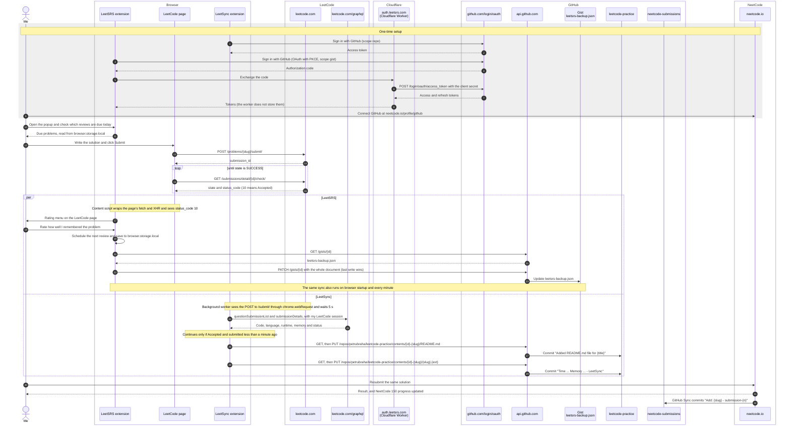

# LeetCode-Practice

My LeetCode solutions, synced automatically from LeetCode to this repository.

## Goal

Work through the [NeetCode 150](https://neetcode.io/practice/practice/neetcode150) roadmap:

- **One new problem per day**, following the NeetCode 150 order.
- **Plus the reviews LeetSRS says are due that day**, so older problems stay fresh through spaced repetition.

## Tools

These are included as git submodules at the top level of this repository:

- [LeetSRS](https://github.com/mattcdrake/LeetSRS): browser extension for spaced repetition on LeetCode. I rate how well I remembered each problem, and it schedules the next review. It also tracks progress on the NeetCode 150 roadmap.
- [LeetSync](https://github.com/LeetSync/LeetSync): browser extension that pushes every accepted LeetCode submission to this repository (one folder per problem, with its `README.md`).
- [neetcode-submissions](https://github.com/petrubraha/neetcode-submissions): my NeetCode solutions, pushed automatically by NeetCode's GitHub Sync.

## Daily workflow

1. **Solve the new problem.** Pick the next unsolved problem from NeetCode 150.
2. **Check the extension.** Open LeetSRS to see which problems are due for review today.
3. **Solve on LeetCode.** Submit the new problem and the due reviews on LeetCode. LeetSync commits each accepted solution here.
4. **Resubmit on NeetCode.** Submit the same solution on NeetCode so its NeetCode 150 progress tracker stays in sync. NeetCode's GitHub Sync commits it to `neetcode-submissions`.

## Infrastructure

What happens behind the workflow, from the one-time GitHub sign-ins to the commits each submission produces:



## Cloning

```sh
git clone --recurse-submodules https://github.com/petrubraha/leetcode-practice.git
# or, in an existing clone:
git submodule update --init
```
